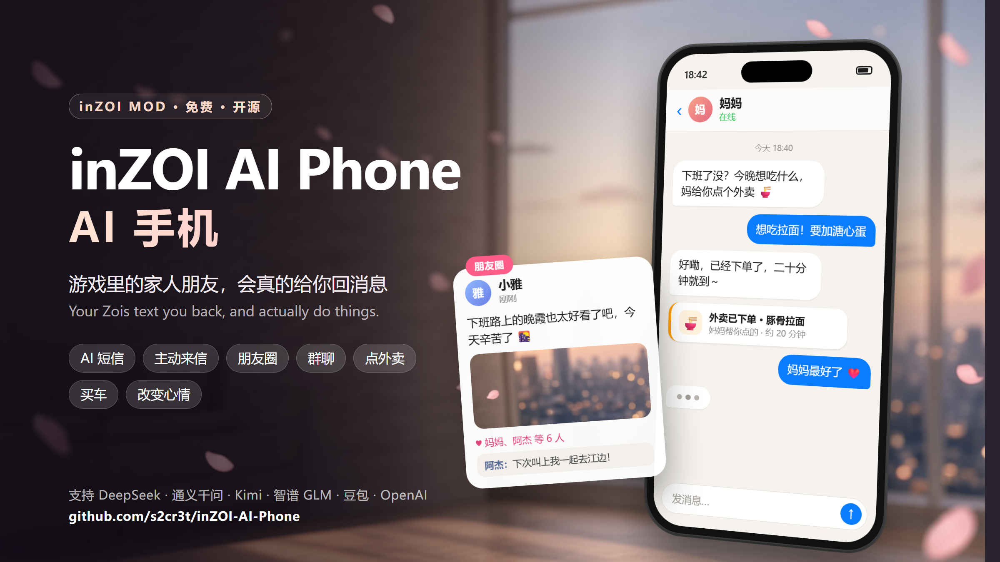

<div align="center">



# inZOI AI 手机 · inZOI AI Phone

**游戏里的家人朋友，会真的给你回消息。**<br>
**Your Zois text you back, and actually do things.**

[](https://github.com/s2cr3t/inZOI-AI-Phone/releases/latest)
[](LICENSE)


[简体中文](#简体中文) · [English](#english)

</div>

---

## 简体中文

给 inZOI 加一部会聊天的手机。家人、朋友用 AI 给你发短信、发朋友圈、回复你的消息，还会真的在游戏里替你去做事。

### 功能

| | |
|---|---|
| 💬 **AI 短信** | 每个角色按自己的性格、关系和经历回复你，记得你们聊过的事 |
| 🔔 **主动来信** | 下班、到家、深夜没回家、状态不好的时候，家人朋友会主动发消息 |
| 🌇 **朋友圈** | 角色会发动态、互相点赞评论，也会回复你的评论 |
| 👥 **群聊** | 一家人或一群朋友在同一个群里聊天 |
| 🍜 **真的会去做** | 聊着聊着就帮你点外卖、买车、改变心情和喜好、做游戏里的互动 |
| 🎨 **完整的手机** | 应用商店、壁纸、深色模式，新闻等小应用可以安装和移除 |

### 安装

1. 到 [Releases](https://github.com/s2cr3t/inZOI-AI-Phone/releases/latest) 下载最新的 `inZOI-AI-Phone-Setup-<版本>.exe`。
2. 双击安装。安装程序会把手机 mod（HouseholdBoard）和互动 mod（HouseholdJournal）装进 `文档\inZOI\Mods`，并装好在后台运行的 AI 手机服务。
3. 启动 inZOI，在 mod 设置里确认 **HouseholdBoard** 和 **HouseholdJournal** 都是打开的。
4. 进入游戏，打开手机里的 AI 设置，选择模型提供商，填入你自己的 API 密钥。

支持 DeepSeek、通义千问（Qwen）、Kimi、智谱 GLM、豆包、OpenAI，以及兼容 OpenAI 接口的自定义地址。AI 调用费用由你自己的账号承担。

**要求：** Windows 10 或 11，正版 inZOI。

> **只从 CurseForge 装了 mod？** 手机里的 AI 需要电脑上的 AI 手机服务才能工作，mod 本身不包含它。请按上面的步骤下载并运行安装包，装好后手机会自动连上，不用重启游戏。

**可选：** `mods/RoomLights_N4CZ4Z` 是一个独立的小 mod，不在安装包里，需要的话手动复制到 `文档\inZOI\Mods\InGame`。

### 问题反馈

已知问题见 [docs/known-issues.zh-CN.txt](docs/known-issues.zh-CN.txt)。遇到问题请在 [Issues](https://github.com/s2cr3t/inZOI-AI-Phone/issues) 反馈，并按已知问题文档最后一节的方法附上诊断包。

---

## English

A chatting phone for inZOI. Your family and friends text you through AI, post moments, answer your messages, and actually do things for you in the game.

### Features

| | |
|---|---|
| 💬 **AI texting** | Every Zoi answers in character, based on personality, relationship and history, and remembers what you talked about |
| 🔔 **They text first** | After work, when they get home, when you are out late or not doing well, family and friends reach out on their own |
| 🌇 **Moments** | Zois post updates, like and comment on each other's posts, and reply to your comments |
| 👥 **Group chats** | A whole household or a group of friends in one chat |
| 🍜 **They act on it** | Order you takeout, buy a car, change moods and preferences, run in-game interactions, all from the conversation |
| 🎨 **A real phone** | App store, wallpapers, dark mode, and small apps such as News that can be installed and removed |

### Install

1. Download the latest `inZOI-AI-Phone-Setup-<version>.exe` from [Releases](https://github.com/s2cr3t/inZOI-AI-Phone/releases/latest).
2. Run it. The installer puts the phone mod (HouseholdBoard) and the interaction mod (HouseholdJournal) into `Documents\inZOI\Mods`, and installs the AI Phone service that runs in the background.
3. Start inZOI and check in the mod settings that **HouseholdBoard** and **HouseholdJournal** are both enabled.
4. In game, open the AI settings on the phone, pick a provider and enter your own API key.

Supported providers: DeepSeek, Qwen, Kimi, Zhipu GLM, Doubao, OpenAI, and any OpenAI-compatible endpoint. AI usage is billed to your own account.

**Requirements:** Windows 10 or 11, a legitimate copy of inZOI.

> **Installed only the mods from CurseForge?** The phone's AI needs the AI Phone service on your PC, which the mods do not contain. Download and run the installer as above; the phone connects by itself, no game restart needed.

**Optional:** `mods/RoomLights_N4CZ4Z` is a small standalone mod that is not in the installer. Copy it to `Documents\inZOI\Mods\InGame` if you want it.

### Feedback

Known issues are listed in [docs/known-issues.zh-CN.txt](docs/known-issues.zh-CN.txt) (Chinese). Please report problems in [Issues](https://github.com/s2cr3t/inZOI-AI-Phone/issues) with a diagnostics package, as described in the last section of that file.

---

## 开发者 · For developers

| 目录 Folder | 内容 Contents |
|---|---|
| `bridge.js`、`server.js`、`lib/` | AI 手机服务（Node.js）· the AI Phone service |
| `native/PhoneHelper.cs` | `inZOIPhone.exe`：开机启动、保管密钥 · starts at logon, keeps the API key |
| `installer/` | Inno Setup 安装脚本 · installer script |
| `mods/` | 三个游戏 mod 的发布版文件 · release files of the three game mods |
| `tools/` | 打包和检查工具 · build and check tools |
| `tests/` | 测试 · tests |
| `docs/promo/` | 宣传图源文件 · source of the banner above |

需要 Requires: Node.js 24, Inno Setup 6, and the .NET Framework 4 compiler (`csc.exe`) that ships with Windows.

```powershell
node tools/build-installer.js --mods mods
node tools/build-test-kit.js --mods mods
```

安装包输出到 `build\dist`。不带 `--mods` 时，从本机 `文档\inZOI\Mods` 里取 mod。<br>
Output goes to `build\dist`. Without `--mods`, the mods are taken from `Documents\inZOI\Mods` on this PC.

本机运行时的配置 `config.json`、密钥 `secrets.json`、聊天数据 `data/` 和日志 `logs/` 不进仓库。<br>
This PC's `config.json`, `secrets.json`, chat data in `data/` and `logs/` are never committed.

## 许可 · License

[CC BY-NC 4.0](LICENSE)：可以自由使用、修改和转发，需要注明出处，**不得用于商业目的**。<br>
Free to use, change and share with attribution, **not for commercial use**.

inZOI 是 KRAFTON 的商标。本项目是玩家自制 mod，与 KRAFTON 无关。<br>
inZOI is a trademark of KRAFTON. This is a fan-made mod, not affiliated with KRAFTON.
